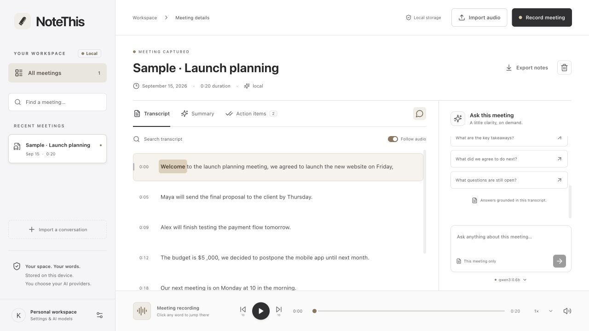

# NoteThis

**Turn a conversation into notes you can use.**

## TLDR

Record a call or upload an audio file. NoteThis turns it into a written transcript, a meeting summary, and a to-do list. Listen back with the words highlighted as they are spoken, or ask questions about what was discussed.

Your recordings and notes are saved on your Mac. Use AI on your computer or connect a supported online service.

## What does it do?

- **Record both sides of a call.** Capture your microphone and the audio playing on your computer, or choose just one.
- **Use recordings you already have.** Upload common audio files, including MP3, M4A, and WAV.
- **Read and listen together.** Follow the highlighted words during playback. Click a word or timestamp to jump to that part of the recording.
- **Get clean, structured notes.** Read formatted summaries with headings, lists, formulas, tables, and simple charts when the meeting supports them. Review decisions and check off action items.
- **Ask your meeting a question.** Try “What did we decide?” or “What do I need to do next?” Jump to the supporting audio from the answer.
- **Add research and diagrams.** Enable web search for questions or useful summary diagrams in Settings when your chosen model supports them. Both start off.
- **Keep a copy.** Export your notes and transcript, download a diagram, or choose **Export LaTeX (.tex)** in the summary for an editable document.

**Transcripts and notes are created after you save the recording**, not live during the call. Keep NoteThis open until your recording is saved. AI can make mistakes, so check important details against the audio.

## How to install

### Download and install

For **Apple Silicon Macs (M1 or newer), running macOS 14.2 or later**:

1. Download **NoteThis-0.5.0-mac-arm64.dmg** from [GitHub Releases](https://github.com/kaylafari/NoteThis/releases).
2. Open the downloaded disk image and drag **NoteThis** into **Applications**.
3. Open NoteThis from Applications. This community build is locally signed, **not Apple-notarized**. If macOS blocks it, use **System Settings → Privacy & Security → Open Anyway** for NoteThis, then confirm the system prompt.
4. Follow the welcome guide. Choose **Prepare local AI** to download the default transcription and language models. Keep the app open and allow several minutes on a reliable internet connection. You can retry an interrupted download from Settings.
5. If you have a ChatGPT subscription, the guide explains how to connect your own account for summaries and meeting questions. Transcription still runs locally unless you choose a separate speech service.
6. When you start your first recording, approve **Microphone** and **Screen & System Audio Recording** access. NoteThis saves audio, not screen video.

**No Terminal, Homebrew, Python installation, or separate Ollama installation is needed for this installer.** The app includes its software dependencies; AI model weights download when you choose Prepare local AI. Local models can run offline after that download. Keep NoteThis in Applications and launch it there on subsequent visits.

The welcome explanations remain available in **Settings → Help & tips**, after **AI models** and **Local setup**. Those tabs also let you retry local setup or configure your own providers.

If Keychain asks, choose **Always Allow** to remember access. See [recording help](docs/recording.md) and [permission help](docs/permissions-persistence.md) if access remains blocked.

### Building from source

Developers can follow the [setup guide](docs/development.md#fresh-setup). Existing source installations can continue opening **Launch NoteThis.command** from the project folder. The downloadable installer works independently of that folder.

## Try your first meeting

1. Load the sample meeting to explore without recording, or choose **Record meeting** or **Import audio**.
2. For a call, choose your audio sources, start recording, then stop and save when finished. Headphones help prevent echo.
3. Wait for the transcript and notes. Play the recording, review your actions, or open **Ask this meeting**.

New summaries use LaTeX formatting automatically. To update an older summary, open it and click **Regenerate**. Formulas and data charts do not require an image-generating AI model.

## Choosing AI and keeping your data private

The default setup uses **Whisper** for transcription and **Ollama** for meeting notes and questions. Both run on your computer.

Connect online services in **Settings** using browser sign-in or an **API key** supplied by the service. Charges may apply. A chat subscription does not automatically include speech transcription.

Online services receive the audio or transcript needed for the task. Web search and diagram settings explain what is shared before you enable them. Features depend on your service and account.

For more detail, see [supported services](docs/providers.md), [model and feature settings](docs/model-discovery.md), or the [developer guide](docs/development.md).
